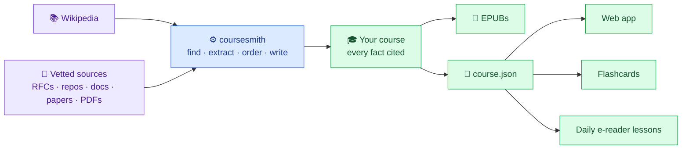
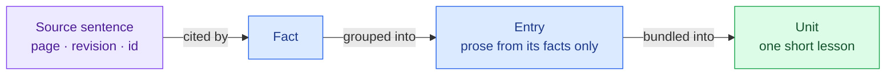
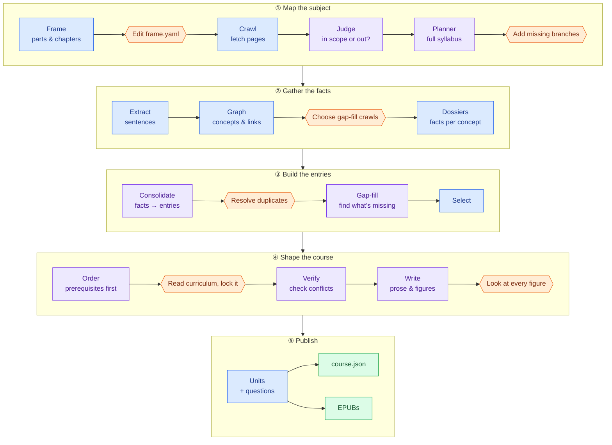
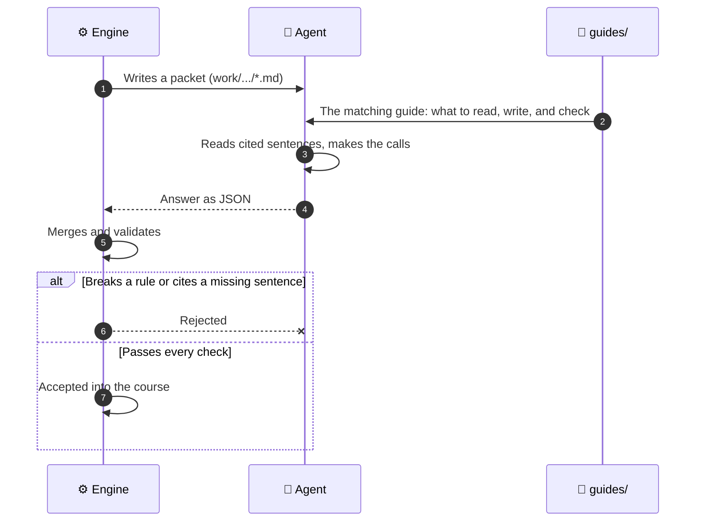

<div align="center">

# coursesmith

**Turn any subject into a complete course, built from sources you can check.**

Every fact traces back to the exact sentence it came from.


</div>

---

## What it does

Give coursesmith a subject. It can be a whole field like soil science, a mid-sized topic like plate tectonics, or a
narrow question like *how do full-range, flat-response speakers work?*

coursesmith then does the work a good teacher would do before a class:

1. **Finds** the pages a course on that subject needs.
2. **Pulls out** their facts and merges the ones that overlap.
3. **Orders** them so each idea builds on the last, from foundations to advanced.
4. **Writes** them up as clear prose, with figures and optional questions.
5. **Splits** the whole thing into short lessons you can read one a day.



What you build on top is up to you. EPUB export is built in, and `course.json` holds everything else you need.

## The one rule

> [!IMPORTANT]
> **Every fact comes from a cited source sentence. Nothing comes from a model's general knowledge.**
>
> Wikipedia is the default source. You can add others, but only ones you approve. Language models help find pages,
> judge scope, order ideas and write prose. They work only from the cited facts they're handed.

Here's what that rule looks like in practice. Each layer of the course points back to the one below it, all the way
down to a sentence on a specific page at a specific revision.



## See it in action

Four finished courses live in their own repo,
[coursesmith-courses](https://github.com/ggroshans/coursesmith-courses). This repo holds only the engine.

| Course | Order | Size |
|---|---|---|
| **Soil science** | foundations → advanced | 2,629 entries in 584 units |
| **Nature economy** | foundations → advanced | 3,932 entries in 874 units |
| **Earth history** | chronological | 1,672 entries in 365 units |
| **System design** | foundations → advanced | 1,127 entries in 322 units |

Each one ships `output/course.json` (the whole course), `output/course.md` and `output/curriculum.md`.

<details>
<summary><b>A sample entry from the soil science course</b></summary>

> **Half solid, half empty: what a soil is made of**
>
> Half of a typical soil is not solid at all. About 50% of its volume is solids, 45% mineral grains and 5% material
> from living things, alive or dead. The other 50% is pores, half filled with water and half with gas. Soil
> composition describes these proportions. In the short term the mineral and organic shares stay constant, while
> water and gas trade places. A rise in one is balanced by a fall in the other. …

Each sentence of that prose rests on facts, and each fact cites the source sentences behind it.

</details>

---

## Quick start

### 1. Install

```sh
python3 -m venv .venv
.venv/bin/pip install --upgrade pip
.venv/bin/pip install -e .
.venv/bin/python -m unittest discover -s tests -t .
```

You need Python 3.9 or newer. Nothing else: no database, no servers. The page cache and the sentence index are
plain local files under `cache/`.

### 2. Tell Wikipedia who you are

Wikimedia asks crawlers to leave a way to contact them. Set `COURSESMITH_CONTACT` to an email address or URL, or
write it to `cache/contact.txt`. `crawl` won't run without one.

The crawler is polite by design. It makes at most one request every two seconds, asks for no more than 50 titles
at a time and backs off when told to (`retry-after`). A small subject crawls in minutes. A large one takes a few
hours.

### 3. Pick a workspace

A course is a folder, `subjects/<slug>/`, that lives inside a **workspace**. The engine reads and writes only the
workspace. Its page cache (`cache/`) and EPUBs (`build/`) stay in the engine checkout and aren't committed.

```sh
coursesmith --workspace ~/my-courses init my-subject --title "..."
# or set it once:
export COURSESMITH_WORKSPACE=~/my-courses
```

A workspace can be a plain folder or a git repo of your own. If you don't set one, it's the engine checkout itself.

### 4. Start a subject

```sh
coursesmith init frfr-speakers --title "How FRFR speakers work" \
    --seed "Full-range speaker" --seed "Loudspeaker" --category Loudspeakers
```

This creates `subjects/frfr-speakers/subject.yaml`, with every setting explained in a comment. Edit it, then work
through the pipeline below. Run `coursesmith status` anytime to see where each subject stands.

---

## How a course gets built

Building a course takes five phases. Three kinds of workers share the job, and the colors below show who does what.

🟦 **The engine** runs a command &nbsp;·&nbsp; 🟪 **An agent** runs a judgment pass &nbsp;·&nbsp; 🟧 **You** review a
checkpoint &nbsp;·&nbsp; 🟩 **Output**



### Every stage, step by step

Every command takes the form `coursesmith <command> <subject> [args]`. Run `coursesmith <command> -h` for help with
any one of them.

| Stage | Commands | 🟧 Your part |
|---|---|---|
| **Frame** | `frame build` | **Edit** `frame.yaml` (parts, chapters, seeds). Label `scope/calibration.csv`, then run `scope tune`. |
| **Crawl** | `crawl [--depth N]`, then `crawl --hubs` | |
| **Judge** | `scope judge-packets`, judge passes, `scope judge-merge`, `crawl --judged` | Spot-check `scope/judge.json`. |
| **Syllabus** | `frame plan-packet`, planner pass, `frame resolve`, `crawl --judged`, `dossier --phrases` | **Add** new branches to `frame.yaml`. Read `reports/syllabus.md`. |
| **Extract** | `extract` | |
| **Graph** | `graph build [--pageviews]` | |
| **Coverage** | `report coverage` | **Decide** which gaps to crawl for. |
| **Dossiers** | `dossier` | |
| **Consolidate** | consolidation passes, then `finalize` | Resolve `reports/duplicates.md`. |
| **Gap-fill** | `report gaps [--probe]`; `frame add`, `crawl`, `extract`, `graph build`, `dossier --new`, passes, `finalize --merge`, `finalize` | **Choose** the pages. Accept the gaps you can't fill under `gaps: accepted:`. |
| **Select** | `select` | |
| **Order** | `order packet`, ordering pass, `order build` | **Read** `output/curriculum.md`, then run `order lock`. |
| **Verify** | `crawl --context`, `verify`, verification pass | Read every genuine conflict. |
| **Write** | `write skeleton`, writing passes (prose and figures), `write render`, `write check` | Spot-read the prose. |
| **Figures** | `figures` draws `figures.json`: Mermaid flowcharts, cycles, layers, scales, bar charts, trees, tables | Look at every one. |
| **Units** | `units build`. For courses with questions: `write questions`, a question pass, `write render`, then `units build` again (units copy their questions only when built). | |
| **Images** | `images` (only when `edition.images: true`) | |
| **Output** | `export`; `publish build` and `publish check` for EPUBs | |

> [!TIP]
> **Changed some entries?** Re-run this chain:
> `finalize` → (`report gaps` → gap-fill → `finalize`) → `select` → `order build` → `verify` → `write skeleton` →
> `write render` → `units build` → (question pass → `write render` → `units build`) → `export` / `publish build`.
>
> Entry ids never change after `order lock`.

**Lookup commands** help you (or an agent) dig into the sources:

| Command | Shows you |
|---|---|
| `sections`, `page` | A page's sentences, with their ids |
| `search` | Every sentence in the subject that contains a phrase |
| `sent` | Sentences by id |
| `ctx` | The sentences around a phrase |

---

## Passes: where agents do the judgment work

Some steps need judgment, not just computation. Is this page in scope? Which idea has to come first? Do these two
sources really disagree? coursesmith hands those steps to an agent as a **pass**.

The engine never trusts a pass blindly. It checks every answer before accepting it.



Any capable coding agent can run a pass. Point it at the repo, the guide and its packet. Passes over separate
packets can run in parallel, one agent per packet. Give each parallel pass its own scratch folder
(`subjects/<slug>/work/tmp/<pass>/`).

The safety net is strict. `finalize`, `order build`, `write check` and `publish check` reject anything that
breaks the rules, and every fact must cite sentence ids that actually exist.

| Guide | Reads | Writes |
|---|---|---|
| `SOURCES_GUIDE.md` | `work/sources/packet.md` | `work/sources/found.yaml` |
| `JUDGE_GUIDE.md` | `work/scope/judge-packet-NN.md` | `scope/judge/batch-NN.json` |
| `PLANNER_GUIDE.md` | `work/scope/plan-packet.md` | `scope/syllabus.json` |
| `CONSOLIDATION_GUIDE.md` | `work/dossiers/<chapter>/chunk_NN.md` | `entries/draft/<chapter>.partNN.jsonl` |
| `GAPFILL_GUIDE.md` | `reports/gaps.md`, `reports/coverage.md`, gaps files | `frame.yaml` seeds, more draft entries |
| `ORDERING_GUIDE.md` | `work/order/packet*.md` | `work/order/prereqs.NN.json` |
| `VERIFICATION_GUIDE.md` | `verify/worklist.md` | `verify/reviews.json` |
| `WRITING_GUIDE.md` | `work/write/packet-<part>.md`, `questions-packet*.md` | `work/write/fill.<part>.NN.json` |

---

## Beyond Wikipedia

Wikipedia is the default and needs no setup. A subject can also draw on other **vetted** sources: GitHub
repositories, IETF RFCs, official docs sites, PDFs, papers and other MediaWiki sites.

*Vetted* means two things. A person approved the list, and the license was read from the source itself. The crawl
never wanders outside that list.

```sh
coursesmith init system-design --title "System design interview questions" --questions
coursesmith sources discover system-design   # find candidates → scope/sources.candidates.yaml
coursesmith sources packet system-design     # optional: a brief for a web-search session
coursesmith sources merge system-design      #           ...then fold its found.yaml back in
# accept candidates by copying them under `sources:` in subject.yaml, then:
coursesmith sources check system-design --fix-refs   # reads each LICENSE, pins commits, checks allowlists
```

### Naming pages from other sources

A page from another source has a **key**. Wikipedia pages keep their bare titles, so nothing built earlier changes.

| Source | Key example |
|---|---|
| Wikipedia | `Soil` |
| IETF RFC | `rfc>9110` |
| GitHub | `gh>owner/repo/path.md` |
| Docs site | `doc>host/path` |
| Paper | `paper>10.1145/...` |

List keys under `seeds:` or in `frame.yaml`, just like any Wikipedia page.

### When sources disagree

Each source has a **trust tier**. When two sources disagree, the higher tier's value becomes the fact, and the
other is recorded as a conflict.


<p align="center"><sub>Most trusted on the left, least on the right.</sub></p>

### Licenses stay visible

Every entry's tag line, every EPUB's "Sources and license" page and `course.json` name the pages, versions and
licenses used.

- **`distribution: personal`** (the default) allows sources with NonCommercial or NoDerivatives licenses and says so.
- **`distribution: public`** makes `publish check` refuse them.

### Courses made of questions

Set `course_type: questions` and flag parts or single chapters with `question: true`. Now each flagged chapter is one interview-style
question. A **Worked example** entry answers it in longer paragraphs and comes last in its chapter. Before it come
the concepts a good answer relies on.

A question chapter doesn't have to close the course. Put it right after the last concept chapter its answer relies
on, and the questions climb with the course: system design has 26, each placed straight after the chapter that
teaches what it needs.

Capacity math like "about 4 writes a second" is declared as a derived number. The checks recompute it, so it can
never sneak past the sourced-numbers rule. Architecture diagrams use `flow` figures with database cylinders and
tier boxes. Everything else, from the daily units to `course.json`, works the same way.

---

## Subjects of every size

coursesmith scales from a whole field down to a single question. What changes is how you point it at the subject.

| | 🌍 A whole field | 🗺️ A medium topic | 🔍 A niche topic or question |
|---|---|---|---|
| **Example** | Soil science | Plate tectonics | How FRFR speakers work |
| **Main lever** | `hubs` in `subject.yaml` | A few seeds + 1–2 category roots | Two or three seed articles |
| **Frame** | Sketch parts with hints; `frame build` places every hub page | `frame build` with no parts; chapters come from categories | Leave `hubs` empty |
| **Then** | Judge sorts borderline pages; planner lays out the full syllabus | Planner proposes the branches | Lower `scope.threshold` to 3–4; try `crawl --depth 3` |

**For a whole field,** `hubs` means the subject's navbox, index page, Vital Articles sections and WikiProject.
Concepts with no article of their own get assembled from sentences scattered across many pages
(`dossier --phrases`). [`docs/DISCOVERY_DESIGN.md`](docs/DISCOVERY_DESIGN.md) explains how this works and what it
measured on soil science.

**For a niche topic,** lean on the planner and judge passes. They find pages from neighboring fields that the topic
depends on. A question about speakers needs acoustics and electronics pages that never mention speakers in their
titles.

> [!NOTE]
> Some floors are tuned for large subjects and may need lowering for very small ones: `SEED_MIN` and the three-page
> category cluster in `coursesmith/frame/build.py`, `MIN_PHRASE_SENTENCES` in `coursesmith/frame/syllabus.py`, and
> `MIN_LINKS` in `coursesmith/crawl/judge.py`. Units adapt on their own. A course of 7 entries gets two units.

---

## What you get

| Output | Made by | What's inside |
|---|---|---|
| **`output/course.json`** | `coursesmith export` | The outline. Every entry in order with its prose, facts and citations. Units, glossary and questions. The full text of every cited sentence, with its page and revision. |
| **EPUBs** | `coursesmith publish build` | One per unit plus one for the whole course, in `build/epubs/<slug>/`. Each has a sources and license page. |
| **Subject files** | every stage | Each one is documented in [`SCHEMA.md`](SCHEMA.md). |

[`docs/OUTPUT.md`](docs/OUTPUT.md) describes the `course.json` format and includes recipes for a web app,
flashcards and search.

### Keeping a course fresh

Sources change. Here's how a course keeps up:

1. **Re-crawl.** New revisions are stored beside the old ones.
2. **Run `extract`, then `finalize`.** It lists every entry whose cited sentences changed or vanished.
3. **Re-run passes for only those entries.** Everything else stays put.

This works because a sentence id is a hash of its page title and text. Unchanged sentences keep their ids. If the
page cleaner itself gets a fix, `reclean` re-cleans cached pages and carries every citation over to the new ids.

---

## Under the hood

<details>
<summary><b>Repository layout</b></summary>

```
coursesmith/    the `coursesmith` command
  sources/        source adapters (wikipedia, github, html, rfc, pdf, paper), registry, keys, licenses, discover, check
  text/           DOM, Markdown, PDF and bracketed-reference text for every source
  crawl/          API client, page store, cleaning, citations, scope, judge, crawl
  extract/        sentence splitting, the sentence index, mentions, dates
  frame/          hub readers, frame builder, syllabus planner and resolver, coverage
  graph/          concept graph, importance, difficulty, RefD prerequisites
  consolidate/    dossiers, finalize
  order/          selection, pedagogical and chronological ordering
  verify/         OpenAlex/Crossref lookups, authorities, reviews
  write/          writer packets, render, checks
  publish/        units, EPUB, covers, images, checks, export
  port/           reclean
guides/         briefs for the passes
sources/        registry.yaml: domains and repos vetted once, with the license read and when
docs/           design (DESIGN.md), discovery (DISCOVERY_DESIGN.md), output format (OUTPUT.md)
tests/          unit tests
cache/          gitignored: shared page cache keyed by page key and version, sentence index, images
build/          gitignored: EPUBs
```

</details>

**Further reading**

- [`docs/DESIGN.md`](docs/DESIGN.md): the entry schema, verification, ordering and voice
- [`docs/DISCOVERY_DESIGN.md`](docs/DISCOVERY_DESIGN.md): how coursesmith finds what a subject needs
- [`docs/OUTPUT.md`](docs/OUTPUT.md): the `course.json` format and what to build with it
- [`SCHEMA.md`](SCHEMA.md): every file in a subject folder

<details>
<summary><b>Renamed from wikicourse</b></summary>

The package and command were called `wikicourse` before version 0.2.

- `COURSESMITH_ROOT`, `COURSESMITH_WORKSPACE`, `COURSESMITH_CONTACT` and `COURSESMITH_MIN_INTERVAL` replace the
  `WIKICOURSE_*` variables. The old names still work as a fallback.
- The `course.json` format id stays `wikicourse-course`, because readers match on it.
- If you rename the repo folder, update the `course` path in the xteink-daily config. It points at
  `<workspace>/subjects/<slug>/output/course.json`.

</details>

## License

The code is MIT licensed (see [`LICENSE`](LICENSE)).

Course content is a different matter. That covers everything in a workspace's `subjects/` folder and everything the
engine exports. It comes from Wikipedia (CC BY-SA 4.0) and, when a subject lists them, other sources under their own
licenses. Each piece is attributed through the cited revisions and versions. See [`NOTICE.md`](NOTICE.md) for
details.
